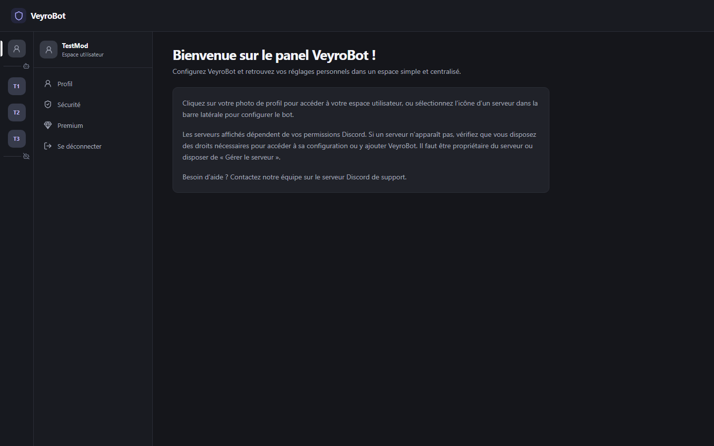
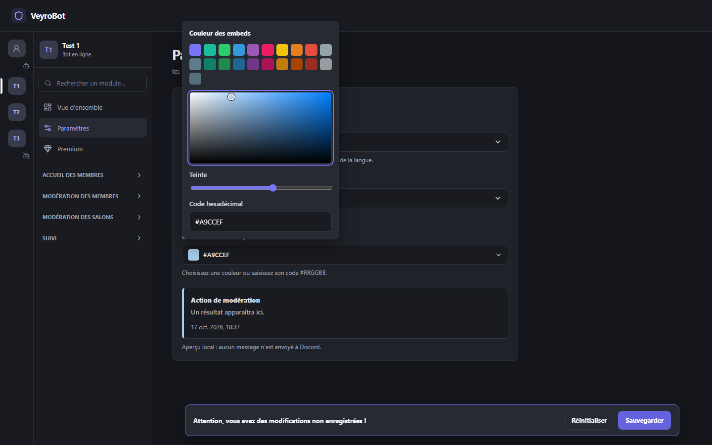
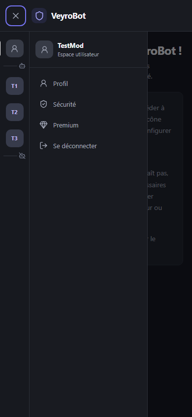

# Validation navigateur du dashboard — 17 octobre 2026

## Résultat

Le parcours Playwright a utilisé Chromium réel contre le serveur Next.js construit et l’API locale, avec PostgreSQL 17 jetable. OAuth et les réponses Discord (profil et guildes) étaient simulés dans l’intégration. Les écritures d’avertissement ont été réellement insérées dans la base de test, puis nettoyées. Aucune requête de modération n’a été envoyée à Discord.

Environnement : Node `24.21.0`, pnpm `10.18.3`, Next.js `16.4.0`, Playwright `1.62.1`, axe-core `4.14.0`, Chrome for Testing/Chromium `151.0.7922.34`, PostgreSQL `17`. Les captures utilisent Chromium à l’échelle 1 : bureau `1440×900`, mobile `390×844`; une vue de profil a également été vérifiée à `900×800`.

## Parcours vérifiés

- Redirection d’un visiteur d’une route protégée; ouverture OAuth simulée; accès à l’accueil utilisateur et aux pages Profil par navigation directe, actualisation, précédent et suivant.
- Navigation clavier depuis le compte vers un serveur; ouverture directe et actualisation de sa vue d’ensemble; infobulle de serveur au focus.
- Chargement de la liste de serveurs en erreur 429 simulée, respect de `Retry-After`, nouvelle tentative manuelle après le délai et conservation de la session.
- Réglages de langue au clavier, contrôle de couleur au clavier, sauvegarde réelle en PostgreSQL, rechargement, réinitialisation d’un brouillon, puis confirmation d’abandon avant de changer de page.
- Activation et sauvegarde du module Avertissements dans la base isolée. Un avertissement créé par le navigateur apparaît dans l’historique. Une seconde écriture réussit alors que la lecture suivante reçoit un 429 simulé; le succès est visible, l’ancien historique reste affiché, une seule écriture a lieu par clic et aucune nouvelle lecture automatique ne part pendant le délai.
- Affichage mobile du menu, focus visible, fermeture par Échap, absence de débordement horizontal à `390×844` et `900×800`, défilement vertical des réglages au clavier, et limites de position du sélecteur de couleur.
- Ouverture au clavier d’une confirmation BAN, vérification que le focus entre dans la boîte, fermeture par Échap et par Annuler avec retour du focus au déclencheur. Le test vérifie qu’aucun POST d’action ne part. Le sélecteur de couleur rend également le focus à son déclencheur après Échap.
- Déconnexion, puis refus d’une route protégée. axe-core ne signale aucune violation de sévérité sérieuse ou critique sur l’accueil utilisateur, les réglages avec sélecteur ouvert, le menu mobile et la page Avertissements.

Le parcours s’exécute avec :

```powershell
$env:DATABASE_URL = '<URL PostgreSQL 17 jetable, migrée>'
$env:RUN_POSTGRES_INTEGRATION = '1'
$env:RUN_DASHBOARD_ROUTE_INTEGRATION = '1'
$env:RUN_DASHBOARD_BROWSER_INTEGRATION = '1'
$env:VEYROBOT_RECOVERY_EPOCH = '<epoch de test uniquement>'
corepack pnpm exec node apps/api/test/integration.mjs
```

En CI, le même parcours est lancé par `pnpm test` avec les services PostgreSQL/Redis isolés, après installation de Chromium par Playwright. Le flag navigateur exige le flag d’intégration API/Next; sans ces flags, il n’est pas exécuté.

## Défauts reproduits et corrigés

- Les initiales visibles sur les icônes de serveur n’étaient pas incluses dans le nom accessible du lien. Le nom conserve maintenant le texte visible et ajoute une description du serveur pour les technologies d’assistance.
- Le dialogue du sélecteur de couleur était sans nom accessible et le nom de son déclencheur n’incluait pas la valeur hexadécimale visible. Le dialogue est maintenant nommé et le déclencheur annonce la couleur courante.
- axe-core a relevé des contrastes insuffisants sur le bouton principal, les catégories et l’onglet actif, l’aperçu, les en-têtes et métadonnées du tableau ainsi que le compteur du formulaire. Les couleurs concernées utilisent maintenant des tons plus lisibles dans la palette existante. La couleur de fond de marque reste inchangée.
- Le parcours E2E utilise des états d’attente déterministes et nettoie chaque dossier créé même si un test échoue.

Les tests et corrections sont dans `apps/dashboard/tools/browser-journey.mjs`, `apps/api/test/integration.mjs`, `apps/dashboard/app/navigation.tsx`, `apps/dashboard/app/configuration.tsx` et `apps/dashboard/app/style.css`.

## Captures de contrôle

Les images sont des captures d’un jeu de test synthétique et peuvent être régénérées par le parcours navigateur. Elles ne constituent pas des comparaisons pixel à pixel, et la capture du sélecteur montre volontairement un brouillon non enregistré.

**Accueil utilisateur — 1440×900**



**Paramètres et sélecteur de couleur — 1440×900**



**Navigation mobile ouverte — 390×844**



## Limites

- Le vrai moteur navigateur est Chromium; Firefox, WebKit, zoom navigateur, lecteurs d’écran et navigation manuelle exhaustive n’ont pas été testés ici. axe-core complète les contrôles interactifs mais ne les remplace pas.
- Les 429 et les réponses OAuth/Discord sont des fixtures Playwright ou API; aucun 429 public réel ni OAuth Discord réel n’a été reproduit pendant cette tranche.
- La base PostgreSQL est réelle mais jetable. Le bot/Gateway n’a pas été connecté et aucun résultat ne démontre un comportement Discord réel.
- Les parcours manuels déjà rapportés par le propriétaire restent des validations séparées; ce rapport ne les revendique pas comme exécutions de l’agent.
- L’essai cible ces vues et dimensions, sans prétendre couvrir tous les navigateurs, tailles, langues, états réseau ou technologies d’assistance.
